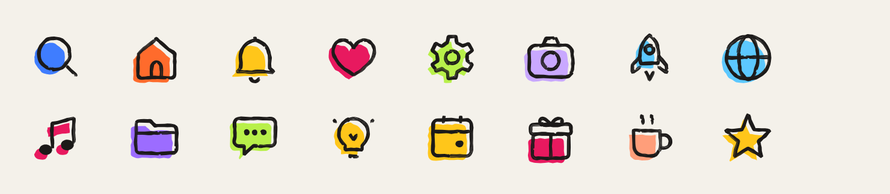

<h1 align="center">Antheo Icons</h1>

<p align="center">Two families of 350 icons for React, each with its own little move on hover.</p>

<p align="center">
  <a href="packages/painted-icons"></a>
</p>
<p align="center">
  <a href="packages/tufted-icons"></a>
</p>

| Package | The look | Install |
|---|---|---|
| [`@antheo/painted-icons`](packages/painted-icons) | Dry-brush ink over a colour plate slipped off the line. On hover the ink re-draws itself, the plate slides into place and the icon does its move. Ink follows your text colour, so it works in light and dark. | `npm i @antheo/painted-icons` |
| [`@antheo/tufted-icons`](packages/tufted-icons) | Cut from felt and laid on a felt tile: fuzzy fibre edges, a soft fibre texture and a shadow under every piece. On hover the felt lifts and moves. | `npm i @antheo/tufted-icons` |

Both families have the same 350 icons with the same names, so you can switch from one to the other by changing the
import.

## Quick start

```tsx
import { Rocket, Heart } from '@antheo/painted-icons';
import { Globe } from '@antheo/tufted-icons';

export function Toolbar() {
  return (
    <>
      <Rocket />
      <Heart size={32} color="#FFD21A" title="Favourite" />
      <Globe size={40} play="loop" />
    </>
  );
}
```

No stylesheet to import and no provider to set up: each package adds its few lines of CSS to the page the first time
an icon renders.

## What you get

- **350 icons per family**, in 24 categories, from interface, arrows, files and data to AI & agents, making, food,
  weather, play and feelings. See them all in each package's `ICONS.md`.
- **One component per icon**, tree-shakeable: a page that imports 5 icons ships 5 icons.
- **Lucide names work too.** `X`, `AlertTriangle`, `Bot`, `ShoppingCart`, `Zap` and nearly 90 more point at our
  icons, so moving over is mostly a change of package name. See [Coming from Lucide](docs/guide.md#coming-from-lucide).
- **A move per icon** on hover (a bell rings, a rocket rises, a gear turns). Turn it off, or let tufted icons loop.
- **Any colours.** Every colour is a prop.
- **Plain files too.** Each package ships every icon as a still SVG and as an animated SVG that loops on its own, even
  in an `` tag.
- **Accessible by default.** Icons are hidden from screen readers unless you give them a `title`, which makes them an
  image with that name. The moves respect reduced-motion settings.
- **Typed.** Written in TypeScript, with the props documented in your editor.

## Docs

- [Guide](docs/guide.md): install, React and Next.js, colours and dark mode, hover triggers, SVG files and CDNs,
  accessibility, performance
- [Painted icons](packages/painted-icons/README.md): props and examples
- [Tufted icons](packages/tufted-icons/README.md): props and examples
- [Changelog](CHANGELOG.md)

## License

Free to use in your own projects, personal and commercial, including client work. Not for resale or
redistribution as icons, not for use in other icon sets or generators, and not for training AI. Read the
[Antheo Icons License](LICENSE) for the exact terms.

Want an icon that isn't here, or the icons in your own colours and sizes? Antheo's icon studio is at
[antheo.studio](https://antheo.studio/icons).
