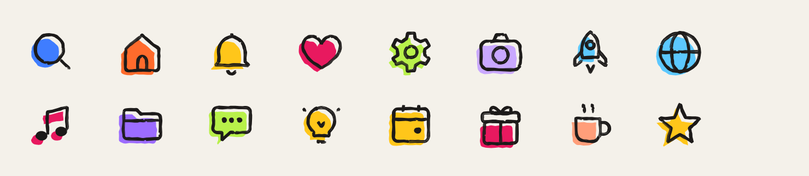

# @antheo/painted-icons

281 hand-painted icons for React. Dry-brush ink over a colour plate slipped off the line, like a print slightly
out of register. On hover the ink re-draws itself, the plate slides into place and the icon does its own move.



```bash
npm i @antheo/painted-icons
```

```tsx
import { Rocket, Heart, Search } from '@antheo/painted-icons';

<Rocket />
<Heart size={32} color="#FFD21A" />
<button className="ap-trigger" aria-label="Search">
  <Search />
</button>
```

The ink takes your text colour by default, so the icons work on light and dark pages without changes.

## Props

| Prop | Type | Default | What it does |
|---|---|---|---|
| `size` | `number \| string` | `24` | Width and height, in px or any CSS length (`"1.25em"`) |
| `ink` | `string` | `currentColor` | The brush ink |
| `color` | `string` | the icon's own | The colour plate behind the ink; `"transparent"` for ink only |
| `slip` | `number` | `1.9` | How far the plate sits off the line at rest; `0` puts it in register |
| `boil` | `boolean` | `true` | Re-draw the ink while hovered |
| `animate` | `boolean` | `true` | Play the icon's move on hover |
| `title` | `string` | | An accessible name. Without it the icon is decorative and hidden from screen readers |

Every other SVG attribute (`className`, `style`, `onClick`, `data-*`…) is passed to the `<svg>`, and `ref` reaches it.

## Names

Every icon has two exports: the plain name and one ending in `Icon`, for when the plain one clashes with your code.

```ts
import { Camera, CameraIcon } from '@antheo/painted-icons'; // same component
```

All 281, with pictures: [ICONS.md](ICONS.md). In code: `iconNames`, `categories` and `icons.json` (names, categories,
search tags, moves).

## Hover from a parent

Give a button, link or row the class `ap-trigger` and the icon inside plays when the whole thing is hovered or
focused from the keyboard.

## Files

- `svg/<name>.svg`: the still icon
- `animated/<name>.svg`: the icon looping its move, on its own, even in an ``
- `styles.css`: the icons' stylesheet, if you'd rather bundle it yourself (it's added automatically otherwise)

```html

```

## More

The [guide](https://github.com/antheo-design/icons/blob/main/docs/guide.md) covers Next.js, dark mode, deep imports,
accessibility and performance. The felt version of the same icons is
[`@antheo/tufted-icons`](https://www.npmjs.com/package/@antheo/tufted-icons).

## License

Free in your own projects, personal and commercial. Not for resale or redistribution as icons, not for other icon sets
or generators, not for AI training. See [LICENSE](LICENSE).
